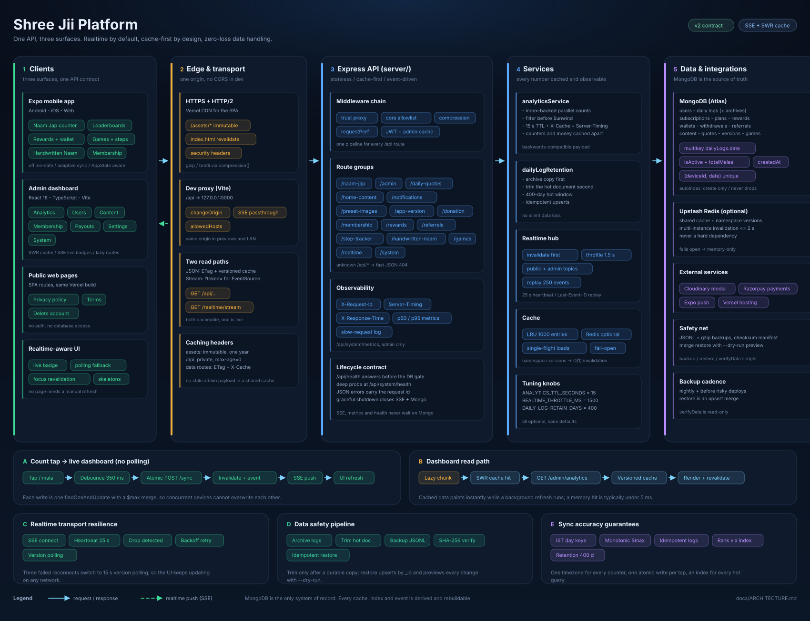
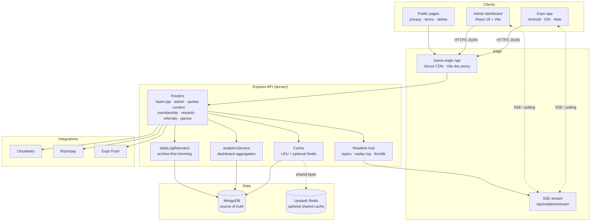
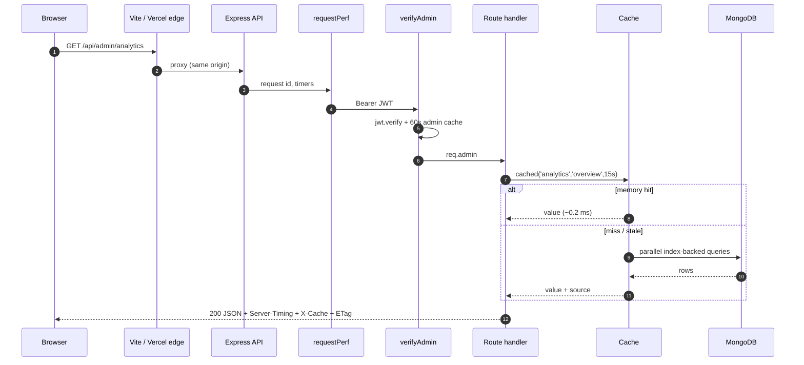
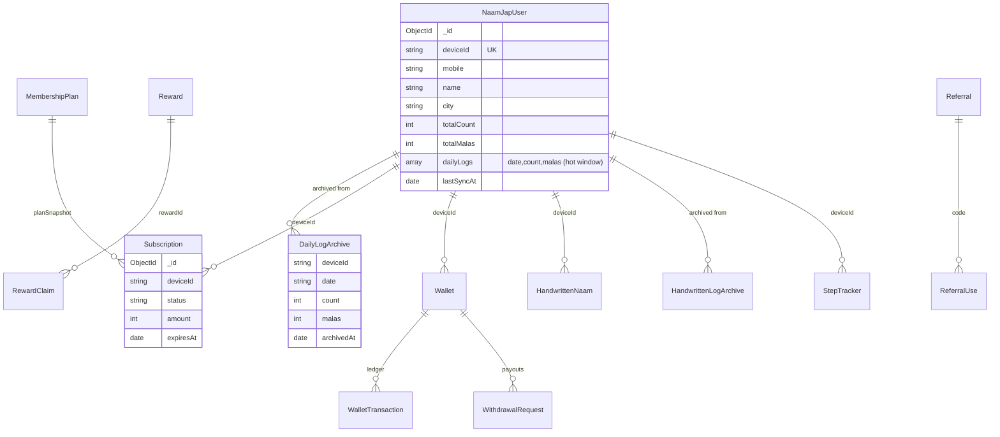

# Shree Jii — Architecture



> The picture above is the whole platform on one page. This document explains
> every box in it, the request paths between them, and the guarantees each layer
> makes.

## 1. System context



## 2. Components

| Layer | Location | Responsibility |
| --- | --- | --- |
| Mobile app | `shree-app/` | Counting, leaderboards, rewards, membership, games. Offline-safe local counters, adaptive sync. |
| Admin dashboard | `src/` | Analytics, users, content, membership, payouts, settings. SWR cache + realtime badges. |
| API | `server/index.js` | One Express app; same code runs on Vercel (serverless) and on a long-lived Node host. |
| Realtime hub | `server/config/realtime.js` | Topic fan-out over SSE, replayable event log, throttling. |
| Cache | `server/config/cache.js` | Two-tier read cache with O(1) invalidation and request coalescing. |
| Analytics | `server/services/analyticsService.js` | Builds the whole dashboard payload with index-backed queries. |
| Retention | `server/services/dailyLogRetention.js` | Copies old logs to archive collections before trimming. |
| Ops scripts | `server/scripts/` | Backup, restore, index bootstrap, data integrity report. |

## 3. Request lifecycle



`X-Request-Id` is echoed on every response and in every server log line, so a
single user report can be traced from the browser devtools to the database.

## 4. Realtime design

```
topic  ∈ analytics | users | leaderboard | stats | quotes | content
         plans | subscriptions | rewards | withdrawals | referrals
         settings | versions | notifications | system
```

* **Transport** — Server-Sent Events (`GET /api/realtime/stream`). One HTTP/2
  stream per tab; no WebSocket server to operate.
* **Auth** — administrative topics require an admin JWT. `EventSource` cannot
  set headers, so the token may be passed as `?token=`; the same verifier is
  used for both.
* **Event shape** —
  `{ id, topic, type, at, day, data }`. `id` is monotonic; reconnecting clients
  send `Last-Event-ID` and receive up to 50 missed events, so a short network
  blip cannot hide an update.
* **Throttling** — `publishThrottled` coalesces bursts per `(topic, type)` inside
  1.5 s and always delivers the trailing event. A thousand devotees tapping at
  once produce one dashboard refresh, not a thousand.
* **Ordering guarantee** — writes bump the cache namespace *before* the event is
  published. A client that reacts by refetching can never read a stale value.
* **Resilience** — 25 s heartbeat comments keep proxies from closing the stream;
  the client reconnects with exponential backoff and, after three failures,
  degrades to 15 s version polling (a ~200-byte request) that emits the same
  local events.
* **Diagnostics** — `GET /api/realtime/status` (admin) returns hub + cache stats.

## 5. Cache design

Every read path is namespaced and versioned:

```
cache key = <namespace>:v<version>:<key>
```

Bumping a namespace increments its version, which instantly orphans every entry
in that namespace (memory and Redis) without scanning or deleting keys. Versions
are mirrored to Redis so other instances invalidate within ~2 s.

| Namespace | Populated by | Invalidated by | TTL |
| --- | --- | --- | --- |
| `analytics` | dashboard payload | any user/quote/reward/membership write | 15 s |
| `users` | admin user list, search pages | register, sync, profile update | 8 s |
| `leaderboard` | all/daily/weekly/monthly boards | TTL only (writes are too frequent) | 10 s |
| `stats` | worldwide + admin counters | write paths | 10–30 s |
| `quotes`, `content`, `versions`, `settings` | content reads | their own writes | TTL |

Three properties keep this safe:

1. **Single-flight** — concurrent identical loads share one database call, so a
   cold cache cannot stampede MongoDB.
2. **Fail-open** — without Upstash the API runs memory-only; a Redis error never
   fails a request.
3. **Budget** — the LRU is bounded (default 1000 entries), so memory usage is
   predictable in a serverless container.

## 6. Data model (core collections)



Indexes are **created, never dropped**, by `npm run indexes` in `server/`:
multikey `dailyLogs.date`, `isActive+totalMalas`, `createdAt`, plus the
collection-specific ones used by payments, payouts and referrals.

## 7. Key endpoints

| Method | Path | Auth | Cache | Notes |
| --- | --- | --- | --- | --- |
| GET | `/api/health` | – | none | Liveness, never touches the DB |
| GET | `/api/system/health` | – | none | Deep health: DB state, cache, hub |
| GET | `/api/system/metrics` | admin | none | p50/p95 per route |
| GET | `/api/realtime/stream` | admin for admin topics | – | SSE |
| GET | `/api/realtime/version` | – | none | Change detection for polling |
| POST | `/api/naam-jap/sync` | – | – | Atomic `$max` merge, one roundtrip |
| GET | `/api/naam-jap/user/:deviceId/snapshot` | – | none | ~200-byte change detector |
| GET | `/api/naam-jap/leaderboard` | – | 10 s | Pre-filtered aggregation |
| GET | `/api/naam-jap/stats` | – | 30 s | Worldwide totals |
| GET | `/api/admin/analytics` | admin | 15 s | Full dashboard payload |
| GET | `/api/naam-jap/admin/users` | admin | 8 s | Search + sort + pagination |
| POST | `/api/system/cache/flush` | admin | – | Namespace invalidation after data fixes |

## 8. Failure modes

| Failure | Behaviour |
| --- | --- |
| MongoDB down | `/api/health` stays 200; data routes return 503 with a JSON body. Connection retries back off in 3 s windows instead of stalling 30 s. |
| Redis down | Cache silently falls back to memory; all features work. |
| SSE blocked | Client switches to version polling and keeps updating. |
| Slow analytics query | Response is still served from cache; slow-request log records the offender with its request id. |
| Duplicate sync | Atomic `$max` merge — no double counting, no lost increments. |
| Interrupted retention | Archive upserts are idempotent; a retry completes safely. |

## 9. Local development

```bash
npm install && npm --prefix server install
npm --prefix server run dev      # API  :5000
npm run dev                      # SPA  :8080, proxies /api → :5000
npm --prefix shree-app run dev   # Expo
```

The dashboard never hard-codes `localhost` in browser code: it calls relative
`/api` paths, and `vite.config.ts` proxies them. That is why the same build
works on a laptop, a phone on the LAN, and a sandboxed preview URL.

---

Related: [PERFORMANCE.md](PERFORMANCE.md) · [DATA-SAFETY.md](DATA-SAFETY.md) ·
[main README](../README.md)
